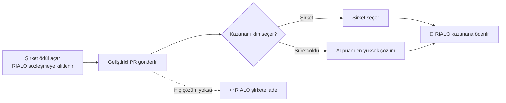

# Rialo Bounty

🇹🇷 Türkçe · 🇬🇧 [English](#english)

**Açık kaynağa katkı ver, RIALO kazan.**
Şirketler RIALO token ile ödül açar, geliştiriciler GitHub PR'ı ile çözüm gönderir. Kazananı şirket seçer ya da seçim süresi dolunca AI puanı en yüksek çözüm kazanır; ödeme akıllı sözleşme tarafından otomatik yapılır.

🔗 **Canlı site:** https://cagdasozsahin.github.io/rialobounty/

> ⚠️ Bu sürüm **Ethereum Sepolia test ağında** çalışır. RIALO bir test tokenıdır, gerçek değeri yoktur. Sözleşmeler bağımsız bir güvenlik denetiminden geçmemiştir.
>
> 🚀 Platformun **Rialo devnet** sürümü (REX doğrulaması, Latch ile AI puanlama, dahili cüzdan): [rialobounty-devnet](https://github.com/Cagdasozsahin/rialobounty-devnet)

---

## Nasıl çalışır?

1. **Kilit** — Ödül açılınca RIALO akıllı sözleşmeye kilitlenir. Sözleşmeyi yöneten hesap bile bu havuza dokunamaz.
2. **Çözüm dönemi** — Son tarihe kadar geliştiriciler GitHub PR linki gönderir. Ödülü açan cüzdan kendi ödülüne çözüm gönderemez.
3. **Şirket seçimi** — Son tarihten sonraki seçim süresi içinde şirket kazananı seçer; ödeme anında yapılır.
4. **AI devreye girer** — Şirket seçmezse ve çözüm varsa, AI puanı en yüksek çözümün sahibine ödeme yapılır.
5. **İade** — Hiç çözüm gelmezse RIALO şirkete geri döner. Çözüm gelmemişse şirket ödülü istediği an iptal edebilir.
6. **Güvenlik ağı** — AI puanlayıcı 30 gün boyunca sonuç vermezse şirket parasını geri çekebilir; fon sonsuza dek kilitli kalmaz.

---

## Özellikler

- 🎯 **Ödüller** — Ödül aç, çözüm gönder, kazanan seç, iptal / iade.
- 🤖 **AI çözüm incelemesi** — Link gerçekliği, ödül uyumu, gereksinim kontrolleri, kod kalitesi, güvenlik riski ve CI sonuçları; 0–100 arası tek puan.
- 📦 **Proje vitrini** — Açık kaynak projeni yayınla, AI ile taranmasını sağla.
- 👤 **Profil** — GitHub ve X hesapları resmi giriş ekranıyla doğrulanır ve profile cüzdan imzasıyla yazılır.
- 🏆 **Puanlar ve sıralama** — Günlük check-in 10, gönderilen çözüm 5, kazanılan ödül 100, yayınlanan proje 50 puan.
- 🏅 **Rozet NFT'leri** — Bronze (100), Gold (300) ve Diamond (700) puanda bir kez mint edilir; toplam arz 1000.
- 🔁 **Test swap** — Sepolia ETH ⇄ RIALO sabit kurlu test havuzu.
- 🌐 **Türkçe / İngilizce** arayüz.

---

## Nasıl denerim?

1. MetaMask'ı kur ve **Sepolia** ağına geç.
2. Bir faucet'ten test Sepolia ETH al.
3. Siteyi aç: https://cagdasozsahin.github.io/rialobounty/
4. Swap bölümünden Sepolia ETH ile test RIALO al.
5. Ödül açmak için önce harcama izni (approve) ver, sonra ödülü oluştur. Ya da açık bir ödüle PR linkinle çözüm gönder.

---

## Sözleşmeler (Sepolia)

| Sözleşme | Adres |
| --- | --- |
| RIALO token | `0xE36227c3ec709EB0b539Ce1004E1Ba71D80f4aC5` |
| BountyPlatform V2 | `0x524c521B1551F3004696bF78Ef3689f6a592Bd00` |
| Dev Showcase | `0xd8DD910E3EBF7301eDd836010A89DDF0Aba9187d` |
| Rialo Profile V2 | `0x510A37FB72Af4653872bBf489158422a240ca033` |
| Rialo Badge NFT v3 | `0x34EE462eb501DC8e2c15D148EbB218F27528d793` |
| Rialo Swap | `0xA6beA7eb6B14614E22D660D976C74613FAC74cB4` |

Hepsi [Sepolia Etherscan](https://sepolia.etherscan.io/) üzerinden incelenebilir.

---

## Güvenlik notları

- Ödeme kuralları ve fonlar akıllı sözleşmededir; site yalnızca arayüzdür.
- AI değerlendirmesi ve GitHub/X doğrulaması zincir dışında çalışır; tek başına garanti sayılmaz.
- AI puanı yardımcı bir sinyaldir; şirketler kararı kendileri verir.
- Mainnet'ten önce bağımsız güvenlik denetimi gereklidir.

---

## 🇬🇧 English

**Rialo Bounty** — contribute to open source and earn RIALO. Companies lock RIALO in a smart contract to open a bounty, developers submit GitHub PRs, and the winner is paid automatically: either the company picks the winner, or after the selection window the highest AI-scored solution wins. With no submissions, the RIALO is refunded to the company; a 30-day safety net prevents funds from being locked forever.

**Features:** bounties · AI solution review (authenticity, fit, requirements, quality, security, CI) · project showcase · GitHub/X-verified profiles · points and leaderboard · Bronze/Gold/Diamond badge NFTs · Sepolia ETH ⇄ RIALO test swap · Turkish/English UI.

**Network:** Ethereum Sepolia testnet (MetaMask). The Rialo devnet version lives at [rialobounty-devnet](https://github.com/Cagdasozsahin/rialobounty-devnet).

Live: https://cagdasozsahin.github.io/rialobounty/
